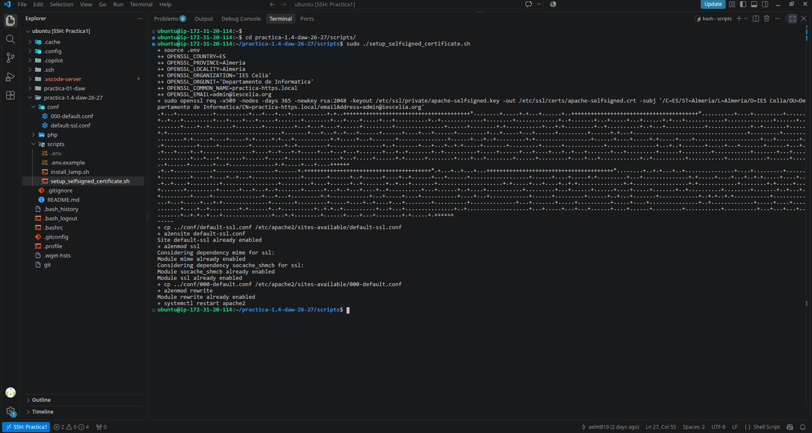
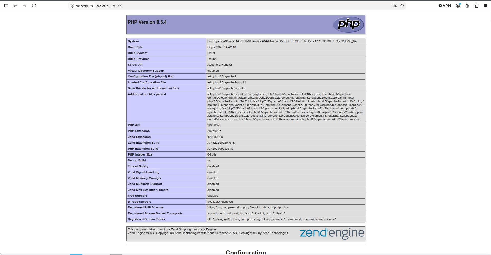
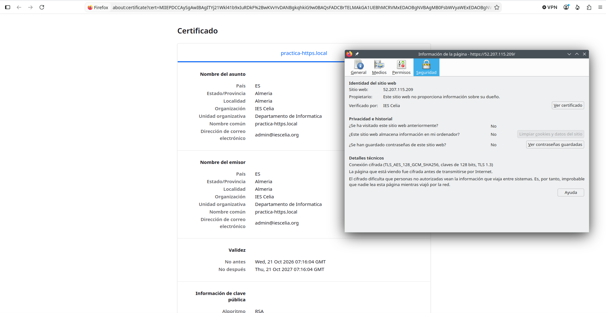

# Practica 1.4: certificado SSL/TLS autofirmado en Apache

## Objetivo

Configurar HTTPS en Apache mediante un certificado autofirmado generado con OpenSSL. El certificado cifra la conexion entre el navegador y el servidor, pero no esta firmado por una autoridad certificadora publica; por ello, el navegador puede mostrar una advertencia de confianza.

## Generacion y configuracion

El proceso se automatiza con `scripts/setup_selfsigned_certificate.sh`. Antes de ejecutarlo, el archivo `scripts/.env` debe definir estas variables, que se usan para construir el nombre distinguido del certificado:

- `OPENSSL_COUNTRY`
- `OPENSSL_PROVINCE`
- `OPENSSL_LOCALITY`
- `OPENSSL_ORGANIZATION`
- `OPENSSL_ORGUNIT`
- `OPENSSL_COMMON_NAME`
- `OPENSSL_EMAIL`

`OPENSSL_COMMON_NAME` debe coincidir con la direccion usada para acceder al servidor. Para esta instancia se configura como `52.207.115.209`. El script añade ese valor al campo `subjectAltName` como tipo IP; si se configura un nombre DNS, lo añade como tipo DNS. Esta extension permite comprobar la identidad del servidor, aunque al ser un certificado autofirmado el navegador seguira mostrando una advertencia de confianza. No publiques valores privados incluidos en `.env`.

Desde la raiz del proyecto, ejecuta el script desde su directorio para que encuentre `.env` y las rutas relativas de `conf/`:

```bash
cd scripts
sudo ./setup_selfsigned_certificate.sh
```

El script realiza estas operaciones:

1. Lee las variables de `scripts/.env`.
2. Ejecuta `openssl req` para crear un certificado X.509 autofirmado RSA de 2048 bits, valido durante 365 dias y sin cifrar la clave privada con una frase de paso.
3. Guarda el certificado en `/etc/ssl/certs/apache-selfsigned.crt` y la clave privada en `/etc/ssl/private/apache-selfsigned.key`.
4. Copia `conf/default-ssl.conf` a la configuracion de sitios de Apache. Este VirtualHost escucha en el puerto 443, activa `SSLEngine` y referencia el certificado y la clave.
5. Habilita el sitio `default-ssl.conf` y el modulo `ssl` de Apache.
6. Copia `conf/000-default.conf`, habilita `rewrite` y configura la redireccion de las peticiones HTTP del puerto 80 a HTTPS.
7. Reinicia Apache para aplicar los cambios.

## Comprobacion

Comprueba que la configuracion sea valida y que Apache este activo:

```bash
sudo apache2ctl configtest
sudo systemctl status apache2 --no-pager
```

Tambien puedes consultar el sujeto, emisor y periodo de validez del certificado:

```bash
sudo openssl x509 -in /etc/ssl/certs/apache-selfsigned.crt -noout -subject -issuer -dates
```

Abre `https://52.207.115.209/` en el navegador. Al ser autofirmado, es normal que el navegador solicite confirmar una excepcion de seguridad. Para una prueba desde terminal, `curl -k` permite continuar sin validar la confianza del certificado:

```bash
curl -k -I https://52.207.115.209/
curl -I http://52.207.115.209/
```

La segunda peticion debe responder con una redireccion hacia HTTPS. No uses `-k` como solucion para un servicio publico: en produccion se debe instalar un certificado emitido por una autoridad certificadora de confianza.

## Evidencias

La primera captura muestra la ejecucion del script y la activacion de la configuracion SSL en Apache:



La segunda captura muestra la pagina de informacion de PHP servida por Apache. La barra del navegador usa HTTP, por lo que esta imagen comprueba PHP, pero no la conexion HTTPS:



La tercera captura muestra los datos del certificado y la informacion de seguridad de la conexion HTTPS:

