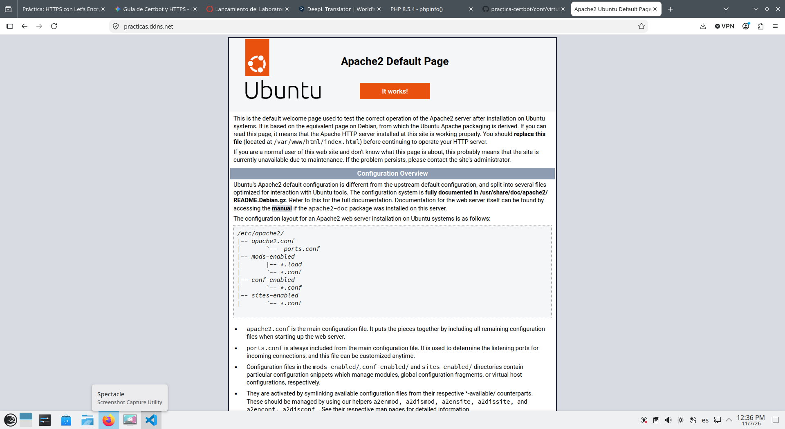
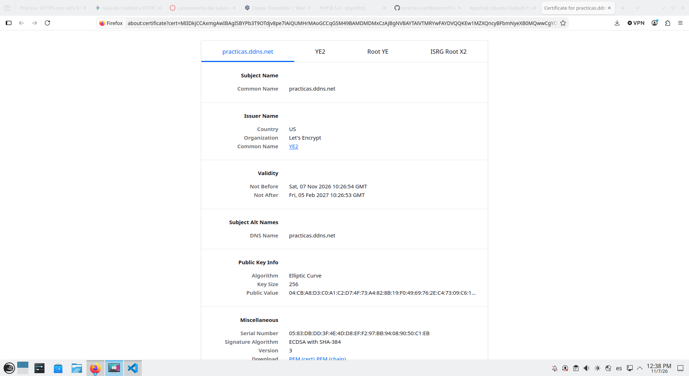

# Practica 1.5: HTTPS con Let's Encrypt y Apache

## Objetivo

Configurar HTTPS en Apache con un certificado gratuito de Let's Encrypt. A diferencia de un certificado autofirmado, este certificado esta firmado por una autoridad certificadora reconocida por los navegadores, por lo que no deberia aparecer una advertencia de confianza si el dominio y el servidor estan configurados correctamente.

## Requisitos previos

- El dominio configurado en `LETS_ENCRYPT_DOMAIN` debe resolver a la direccion publica de este servidor.
- El servidor debe ser accesible desde Internet por los puertos TCP 80 y 443.
- Apache debe estar instalado y activo. Si hace falta instalarlo, ejecuta primero `scripts/install_lamp.sh`.
- El sistema debe tener Snap y `envsubst` disponible. En Ubuntu, `envsubst` se instala con el paquete `gettext-base`.

## Configuracion y ejecucion

El script `scripts/setup_letsencrypt_certificate.sh` obtiene el certificado y configura Apache. Lee estas variables desde `scripts/.env`:

```env
LETS_ENCRYPT_DOMAIN="practicas.ddns.net"
LETS_ENCRYPT_EMAIL="tu-correo@example.com"
```

Sustituye el correo de ejemplo por uno valido y configura el dominio que apunta a este servidor. Desde la raiz del proyecto, ejecuta el script desde `scripts/`, ya que usa rutas relativas para leer `.env` y la plantilla de `conf/`:

```bash
cd scripts
sudo ./setup_letsencrypt_certificate.sh
```

El script comprueba que se ejecuta como root y que las dos variables tienen valor. A continuacion instala Certbot mediante Snap, genera un VirtualHost HTTP desde `conf/virtualhost.conf.template`, lo habilita y reinicia Apache. Por ultimo ejecuta Certbot con el complemento de Apache en modo no interactivo, acepta los terminos de servicio y configura la redireccion de HTTP a HTTPS.

Durante la validacion ACME, Let's Encrypt comprueba que el dominio apunta al servidor y que puede acceder a el. Si la validacion se completa, Certbot configura HTTPS en Apache y guarda los archivos en `/etc/letsencrypt/live/<dominio>/`:

- `fullchain.pem`: certificado del servidor y cadena de certificados intermedios.
- `privkey.pem`: clave privada asociada al certificado. No la publiques ni la copies al repositorio.

La renovacion automatica se gestiona mediante el temporizador de Certbot instalado por Snap.

## Comprobacion y renovacion

Comprueba que Apache tiene una configuracion valida, que el servicio esta activo y que Certbot reconoce el certificado:

```bash
sudo apache2ctl configtest
sudo systemctl status apache2 --no-pager
sudo certbot certificates
```

Comprueba las respuestas HTTP y HTTPS:

```bash
curl -I http://practicas.ddns.net/
curl -I https://practicas.ddns.net/
```

La peticion HTTP debe redirigir a HTTPS si se habilito esa opcion. Al tratarse de un certificado de una autoridad reconocida, no es necesario usar `curl -k`. Puedes probar el proceso de renovacion sin cambiar el certificado activo:

```bash
sudo certbot renew --dry-run
```

## Evidencias

La primera captura muestra la pagina servida por Apache en el dominio configurado:



La segunda captura muestra los datos del certificado de `practicas.ddns.net` y su emisor Let's Encrypt:

